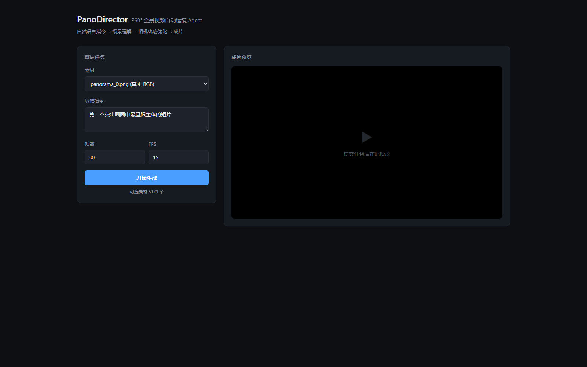

# PanoDirector · 360° 全景视频自动运镜 Agent

> 给一段 ERP 全景视频和一句自然语言指令，输出一段电影感的 NFOV 成片，
> 并给出可解释的运镜决策。

```
输入：全景图 + "剪一个突出画面中最显眼主体的短片"
输出：成片 mp4 + 相机轨迹 + 剪辑方案
```



---

## 核心洞察

整个项目建立在一句第一性原理上：

> **在 ERP 图像上做的任何像素级运算（IoU、距离、池化、速度）都是错的，
> 因为 ERP 是球面的非均匀采样。所有几何量必须以「球面角度」为单位计算。**

ERP 把球面按经纬度线性映射到图像坐标，导致 x 方向每像素对应的球面弧长
正比于 `cos φ`：赤道处 10 像素 ≈ 0.3°，高纬处 10 像素 ≈ 3°。
面积畸变因子 `1/cos φ` 在极点发散——极点这个**单点**被展开成了整条边。

| 层面 | 常规做法（错） | 本项目做法 |
|---|---|---|
| 跟踪关联 | 像素欧氏距离 | 大圆距离 |
| yaw 滤波 | 在 [-180,180) 上直接滤波 → 边界跳变 | `np.unwrap` 提升到 ℝ 后滤波 |
| 检测框 IoU | 像素 IoU | 球面 IoU（Fibonacci 采样 + 立体角加权） |
| 显著性损失 | 逐像素 MSE | `cos φ` 加权 |
| 轨迹求解 | 在 S¹ 上优化 → 跨接缝时跳变 | 提升到 ℝ 后 L-BFGS-B |
| 镜头指标 | 整条拼接轨迹算角速度 | **排除切镜处的跳变** |

**这六个地方用不同数学工具，解决的是同一个问题**：
把周期性在数据边界处理一次，之后各层当普通量处理。

---

## 另一个核心设计：让 LLM 只说「约束」

`EditDSL` 的 pydantic schema 里**没有任何表示坐标的 float 字段**。

```python
class ShotSpec(BaseModel):
    model_config = ConfigDict(extra="forbid")   # 捏造字段会被直接拒绝
    t_start: float
    t_end: float
    subject: int | None          # ← 是 track_id，不是坐标
    shot_type: Literal[...]
    camera_motion: Literal[...]
    fov_deg: float
```

LLM 能说"拍 3 号轨道，中景，跟随"，**不能**说"相机在 yaw=37.5°"。

理由：LLM 输出的是**约束**（可校验、可拒绝、可兜底），而不是**解**
（不可校验、错了也不知道）。这不是靠 prompt 里写"请不要输出坐标"，
而是让它**根本没有字段可填**。

---

## 架构

```
L4 Agent 层     Planner(LLM) → EditDSL → Solver(L-BFGS-B) → Render(NFOV)
L3 表示层 ★     Panorama Scene Graph：符号层(给LLM) ⟷ track_id ⟷ 数值层(给优化器)
L2 感知层       实例提取 → 球面Kalman跟踪(跨边界) → 显著性 → 光流
                调度：子进程模型隔离 + 显存预算
L1 几何层 ★     sphere / projection / region / camera（纯 numpy）
L0 输入层       ERP 图 → 实例/语义标注
```

---

## 快速开始

### 环境

```bash
conda create -n pano python=3.11 -y
conda activate pano

# 国内镜像
pip config set global.index-url https://pypi.tuna.tsinghua.edu.cn/simple
pip config set global.trusted-host pypi.tuna.tsinghua.edu.cn

# PyTorch（CUDA 版需从专用源装）
pip install torch==2.7.1+cu126 torchvision==0.22.1+cu126 \
    -f https://mirrors.aliyun.com/pytorch-wheels/cu126/ \
    -f https://download.pytorch.org/whl/cu126

pip install -e ".[dev,service]"
```

### 数据

需要 **Insta360 Omni360-X** 数据集（CC-BY-NC-4.0，学术用途）：

```bash
export HF_ENDPOINT=https://hf-mirror.com
# 实例分割（必须，提供真实目标）
#   https://hf-mirror.com/datasets/Insta360-Research/AirSim360
# 解压到 C:/pano_data/datasets/nyc_instance/
# 真实 RGB（可选，作为渲染素材）
#   解压到 C:/pano_data/datasets/nyc_raw/
```

详见 [docs/datasets.md](docs/datasets.md)。

### 运行

```bash
pytest tests/ -q                                    # 533 项测试
python scripts/run_benchmark.py                     # baseline 对比
python scripts/vram_probe.py --all                  # 显存实测
python scripts/demo_full.py                         # 端到端出片
python scripts/demo_gallery.py --count 3            # 多素材对比
uvicorn pano_agent.service.api:app                  # Web Demo → localhost:8000
```

---

## 结果

### Baseline 对比

| Baseline | 居中率 | 平滑 (°/s²) | 角速度合规 | 峰值速度 |
|---|---|---|---|---|
| `center_crop`（固定机位） | 22% | 0.0 | 100% | 0°/s |
| `saliency_greedy`（逐帧贪心） | 100% | **634.3** | 64% | 97°/s |
| `saliency_smooth`（+低通） | 100% | 69.9 | 58% | 57°/s |
| **`ours`** | 100% | 92.7 | **83%** | **46°/s** |

输入噪声的角加速度基准为 **634.3 °/s²**。

**最有说服力的一条**：`saliency_greedy` 的居中率 100%（每帧都对准），
但平滑度**恰等于输入噪声基准**——它完全没做时序平滑。
这是「逐帧最优 ≠ 全局最优」的直接实验证据。

**关于 `ours`**：它的平滑度不如 `saliency_smooth`，但后者不感知速度
约束（峰值 57°/s 超出配置上限）。**这是权衡，不是碾压**。

### 端侧性能

| 模型 | 峰值显存 | 延迟 |
|---|---|---|
| YOLO11n @640×1280 | 64.7 MiB | 12.4 ms |
| 实例提取（纯 CPU） | 0 | 262 ms |

端到端（30 帧）约 11-15 秒。详见 [docs/benchmark.md](docs/benchmark.md)。

---

## ⚠️ 这个项目不做什么

诚实声明，避免误读：

- **不是真实视频验证** —— 数据集是静态全景图，跟踪质量在**受控合成
  序列**上验证（真实实例形状 + 环绕平移模拟运动）
- **没有 Pano2Vid 的 DTW 对比** —— 该数据集的链接未能获取，
  轨迹质量只用可自洽计算的指标
- **显著性为弱监督** —— 无语动仪 GT，用语义 mask 前景类作代理
- **LLM 规划的 A/B 未做** —— Demo 默认走纯优化器降级路径
- **主体选择缺审美判断** —— 系统会选"近距离的大建筑"导致画面被占满

详见 [docs/report.md](docs/report.md) §6 局限。

---

## 项目结构

```
src/pano_agent/
  geometry/   sphere / projection / region / camera     1224 行
  perception/ instance / track_spherical / registry / … 2807 行
  sir/        schema / build / caption                  1079 行
  agent/      dsl / planner / providers                 1204 行
  optimize/   solver                                     421 行
  render/     nfov                                       267 行
  eval/       baselines / metrics_traj                   649 行
  service/    pipeline / api                             710 行
                                                     共 8508 行

tests/                                                  5404 行 / 533 项
docs/    report.md（技术报告）/ resume.md（简历文案）/ benchmark.md
```

---

## 许可

Apache-2.0

数据集（Omni360-X）为 CC-BY-NC-4.0，**仅限学术与非商业用途**。
